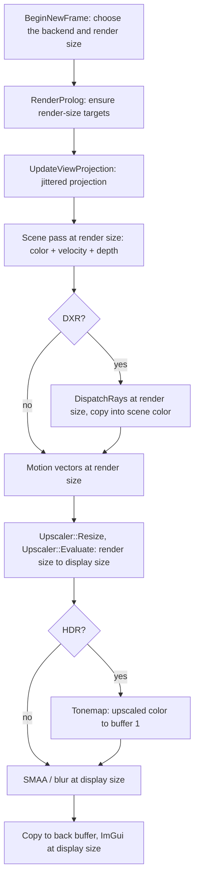

# Temporal anti-aliasing and upscaling

The scene can render at a fraction of the window's size. A temporal backend then reconstructs the window-size image
from several jittered frames. There are two backends: the engine's own TAA and AMD FSR (through the FidelityFX API).
DLSS is meant to plug in behind the same interface. This document covers:
- how a frame flows;
- what the platform and a backend each own;
- how the TAA backend reconstructs the image;
- how to add a backend.

| File | What it holds |
|---|---|
| `Game/Upscaler.h` | The `Upscaler` interface, `UpscaleFrame` / `UpscaleInputs`, `UpscalerContext`, `CreateUpscaler` |
| `Game/UpscalerMath.h` | Render size from scale, LOD bias, jitter phase count, presets (no graphics API; unit-tested) |
| `Game/UpscalerTaa.cpp` | The TAA backend: history, root signature, pipelines, `TaaConstants`; `CreateUpscaler` |
| `Game/UpscalerFsr.cpp` | The FSR backend: the FidelityFX loader, context and dispatch |
| `ThirdParty/FidelityFX/` | The FidelityFX API headers and AMD's signed DLLs (v2.4.0; see its `README.md`) |
| `Game/Shaders/Taa.hlsl` | `TaaResolveCS` (native) and `TaauResolveCS` (upscaling) |
| `Game/RenderPlatform12.cpp` | Choosing the backend, render-size targets, jitter, LOD bias, calling `Evaluate` |
| `Game/Settings.h` | `m_antialiasing` (the mode), `m_renderScale` (the fraction of the window), `m_upscalerSharpness`, `m_upscalerFrameTimeMs` |

## Two sizes

The **display size** is the window's. The **render size** is `UpscalerMath::RenderSize(display, scale)`:
- each axis is scaled and rounded to the nearest pixel;
- it is at least one pixel and never larger than the display.

They differ only while a temporal backend is active and the scale is below 1.

| Render size | Display size |
|---|---|
| Depth (`m_pDepthStencil`), velocity (`m_motionVelocity`) | Back buffers, off-screen buffers 1 and 2 |
| Scene color (`m_sceneColor`: HDR float, or LDR while upscaling) | Upscaled HDR color (`m_upscaledColor`) |
| DXR output, the ray dispatch | TAA history (owned by the backend) |
| Motion debug history | Tonemap, SMAA, blur, ImGui, captures |
| `m_viewPort`, `m_scissorRect` (scene passes, jitter) | `m_displayViewport`, `m_displayScissor` |

Rules:
- **Only temporal backends upscale.** `None` and `SMAA` always render native, whatever `m_renderScale` says.
- **The motion debug views force native**, because they compare pixels between frames.
- **The aspect ratio doesn't change:** both axes scale by the same factor, so the projection is untouched.
- **Native LDR renders straight into off-screen buffer 1**, as before. HDR always renders into `m_sceneColor`;
  LDR does too while upscaling.

The render size is chosen once per frame, in `BeginNewFrame` (`ChooseFrameUpscaler`). Settings changed by the UI
during a frame take effect at the next. `RenderProlog` waits for the previous frame first, then (re)creates any
render-size target whose size or format changed (`EnsureSceneTargets`). Recreating depth resets the camera history,
so the first frame at a new scale starts its accumulation afresh.

## A frame



In PIX the passes nest as `Post-processing` › `Motion vectors` › { `Velocity`, `Upscale (TAA)` › `Resolve` or
`TAAU resolve`, `Tonemap` }.

### Jitter

`UpdateViewProjection` offsets the projection by a sub-pixel amount, measured in **render** pixels, from Halton(2, 3).
- **Sequence length:** the backend's `JitterPhaseCount`. The default is `ceil(8 * (display / render)^2)`: 8 at
  native, 18 at Quality, 32 at Performance. Every display pixel then gets samples close by within a cycle.
- **Which point:** frame *n* uses point `n % phases + 1`.
- **Where it applies:** ray generation unprojects through the jittered matrix, so primary rays follow it. Motion
  vectors use the unjittered matrices.
- **What the backend gets:** the offset as `UpscaleFrame::jitterPixels`.

### Texture LOD bias

At a lower render size, each pixel covers more texture, so textures would come out blurrier. The platform puts the
backend's `MipBias(render, display)` (default `log2(render / display)`: −0.58 at Quality, −1 at Performance) into
`CBChangesEveryFrame::renderScale` (x = bias, y = 2^bias). Three places use it:
- **Raster material samples** in `Tree.hlsl` use `SampleBias(..., renderScale.x)`. These are base color, tint,
  normal, specular and metallic-roughness. The shadow pass, environment lookups and debug quads stay unbiased.
- **The hashed alpha test** uses the biased LOD and a display pixel's footprint (`footprint * renderScale.y`).
- **Ray tracing** scales the ray cone's pixel step by `renderScale.y` (`RaytracingLibrary.hlsl`), so filtered
  texture samples match a display pixel.

The bias is the backend's at every scale. TAA's is 0 at native, so with TAA (and without a backend) every shader
produces exactly what it did before upscaling existed. FSR asks for one level more, `log2(render / display) − 1`,
which is −1 at native (its NativeAA).

## The interface

```cpp
class Upscaler {
public:
    virtual const wchar_t* Name() const = 0;                 // PIX scope and debug UI
    virtual bool Supports(float renderScale) const = 0;      // e.g. DLSS: 0.33-1
    virtual float MipBias(UpscalerSize render, UpscalerSize display) const;          // default log2(r/d)
    virtual UINT JitterPhaseCount(UpscalerSize render, UpscalerSize display) const;  // default ceil(8 (d/r)^2)
    virtual HRESULT Resize(UpscalerSize render, UpscalerSize display, DXGI_FORMAT colorFormat) = 0;
    virtual HRESULT Evaluate(ID3D12GraphicsCommandList* list, const UpscaleFrame& frame) = 0;
};
std::unique_ptr<Upscaler> CreateUpscaler(Settings::Antialiasing mode, const UpscalerContext& context);
```

### Who owns what

| The platform (`RenderPlatform12`) | A backend |
|---|---|
| Choosing the backend per mode, creating it on first use | Its history, root signature and pipelines |
| Render size, viewports, render-size targets | Rewriting its own descriptors every `Evaluate` |
| Jitter sequence, using the backend's phase count | Deciding when its history is usable (`reset`, frame gaps, size changes) |
| LOD bias, using the backend's `MipBias` | Its constants and filtering |
| Motion vectors, depth, the output target | Barriers on its own resources |
| Barriers into and out of the stated states | |
| The `Upscale (<Name>)` PIX scope | Nested PIX scopes for its passes |

### Lifetime

- **Creation.** `ChooseFrameUpscaler` calls `CreateUpscaler(mode, context)` the first time a mode is used after a
  level loads, and keeps the result in `m_upscalers`. A null result, for a mode with no backend or one that failed to
  initialize, is kept too. The mode then renders without a backend, and the failure is logged.
- **Release.** Backends are destroyed in `UninitGameLevelGraphics`, with the GPU idle.
- **`Resize`** runs every frame before `Evaluate`, after the previous frame has finished. It must be cheap when
  nothing changed. To release a resource it replaces, it calls `context.retire(resource)`, which keeps it alive until
  the frame being recorded completes.

### `UpscalerContext`

- `device`.
- `descriptors`: a block of 16 shader-visible CBV/SRV/UAV descriptors in the platform's heap, reserved for this mode
  (`Upscaler0_HeapOffset + mode * 16`). Only one frame is in flight and the previous one has finished when `Evaluate`
  runs, so a backend may rewrite its descriptors every frame. The TAA backend does.
- `loadShader(filename, bytecode)`: loads a `.cso` from the deployed shaders. The bytecode stays valid while the level
  is loaded.
- `retire(resource)`: deferred release, as above.

### `UpscaleFrame`

| Field | Meaning |
|---|---|
| `textures.color` | Render size. Linear HDR (`R16G16B16A16_FLOAT`) when `hdr`, otherwise display-encoded `R8G8B8A8_UNORM` |
| `textures.depth`, `depthFormat` | Render size; device depth, 0 near and 1 far (**not** reversed); typeless, read as `R32_FLOAT` |
| `textures.motion` | Render size, `R16G16_FLOAT`: the UV offset from this pixel to where it was last frame (current → previous), **without** jitter. Pixels without object motion hold camera motion from depth |
| `textures.exposure`, `reactive`, `transparency` | Optional, null today; reserved for FSR and DLSS |
| `textures.output` | Display size, a typed UAV in the color's encoding: `m_upscaledColor` with HDR; off-screen buffer 1 while upscaling LDR; buffer 2 at native LDR (the platform copies it to buffer 1) |
| `render`, `display` | The two sizes |
| `jitterPixels` | The projection offset this frame, in render pixels: render pixel *p* sampled the scene at `p + 0.5 − jitter` in unjittered render pixels |
| `motionToPixels` | The render size; multiply `motion` by it for render pixels (FSR's and DLSS's motion vector scale) |
| `hdr` | Color is linear light; tonemapping follows at display size |
| `reset` | The camera history is invalid: the first frame, a resize, a level load, a new render size |
| `view`, `projection` | This frame's camera without jitter (DirectXMath row vectors) |
| `clipToPreviousClip` | Current clip space to last frame's, without jitter |
| `nearZ`, `farZ`, `fovY` | From `ProjectionData` |
| `frameIndex` | `RenderData::frame`; a backend treats a gap as a reset |
| `frameTimeMs` | Time since the previous frame began, measured with `QueryPerformanceCounter`, or `Settings::m_upscalerFrameTimeMs` when set (render tests fix it at 1/60 s, so FSR captures repeat exactly) |
| `sharpness` | `Settings::m_upscalerSharpness`, 0 to 1 (FSR's sharpening pass; TAA ignores it) |
| `preExposure` | 1 |

**Resource states:** the inputs are in `NON_PIXEL_SHADER_RESOURCE` and the output in `UNORDERED_ACCESS`, on entry and
on return.

**Descriptor heaps:** a backend may bind its own descriptor heaps and root signatures during `Evaluate` (FSR does).
The platform rebinds its heap afterwards, and every later pass sets its own root signature.

## The TAA backend

`TaaUpscaler` (`UpscalerTaa.cpp`) keeps two display-size `R16G16B16A16_FLOAT` histories and ping-pongs between them.
- **Descriptors:** each evaluation writes six of them: color, motion, depth and the read history as SRVs, and the
  output and the written history as UAVs.
- **Root signature:** 16 root constants (`TaaConstants`), the SRV table, the UAV table and a linear clamp sampler.
- **History validity:** the history is valid when `reset` is false and it holds the previous frame (`frameIndex − 1`).
  A new display size recreates it; a new render size invalidates it.

**Native** (render = display) dispatches `TaaResolveCS`, the original TAA. It resolves each pixel against its own
sample and its 3×3 neighborhood, as described at the top of `Taa.hlsl`. Its output is bit-identical to TAA before the
interface existed.

**Upscaling** dispatches `TaauResolveCS`, one thread per display pixel:
1. **Map the display pixel into render space** (`uv * renderSize`) and pick the render pixel whose sample lies
   nearest, allowing for the jitter.
2. **Filter the 3×3 render pixels around it.** Each sample is weighted by a Gaussian of its distance to the display
   pixel center, in **display** pixels (σ ≈ 0.32). That is close to the one-pixel box native TAA accumulates. Wider
   kernels, or distances in render pixels, softened static detail noticeably.
3. **Reproject the history** with the velocity of the nearest-depth render pixel, using the same Catmull-Rom fetch as
   native.
4. **Clip the history** to the 3×3 neighborhood's YCoCg box (mean ± γσ), with two changes for upscaling. A frame's
   sparse samples can miss detail the display-size history holds, and a tight box would strip it.
   - Still pixels widen the box by up to `UpscaleStillClipScale` (2×). "Still" fades out linearly between no
     motion and 1/8 display pixel per frame; static content has exactly zero motion.
   - Still pixels also clip only in proportion to the nearest sample's weight. Without a sample close by, the
     neighborhood says little about the pixel, and clipping would erase thin branches that frame missed.
   - Moving pixels keep the tight box and clip fully, so stale history doesn't ghost.
5. **Blend** with a current weight of `CurrentWeight × nearestWeight`. Display pixels with no close sample this frame
   lean on history. The inverse-luminance weighting and the HDR compression match native.

Measured against a 4-sample reference (see `Tests/RenderRegression/test-upscaling.ps1`):
- Quality's error is 1.02–1.14× native TAA's, and Performance's 1.08–1.41×.
- After a camera step the error is at most 1.45× and 1.52×.
- On static rock, Quality keeps about 92% of native's fine detail and Performance about 84%.
- Known weakness: thin, swaying branches in the distance come out fainter than at native.

## The FSR backend

`FsrUpscaler` (`UpscalerFsr.cpp`) drives AMD FSR through the FidelityFX API, from the SDK files vendored in
`ThirdParty/FidelityFX`.
- **Loading.** It loads `amd_fidelityfx_loader_dx12.dll` from the executable's folder with `LoadLibraryW` and
  resolves the API's functions with `GetProcAddress`. There is no import library. The loader finds
  `amd_fidelityfx_upscaler_dx12.dll` in the same folder; the `TreeClassic` build copies both there.
- **Unavailable.** Without the DLLs, or without an upscaler provider for the device, `CreateUpscaler` returns null
  with the reason. The debug UI shows it in orange, the frame renders without anti-aliasing, and render-test reports
  carry it as `"upscaler": "unavailable: ..."`.
- **Provider.** The API picks the newest provider the GPU supports: FSR 4 on recent AMD GPUs, FSR 3.1 elsewhere. The
  chosen version shows in the debug UI and in render-test reports (`"upscaler": "FSR 3.1.6"` on an RTX 5080).
- **Context.** `Resize` (re)creates the context when the display size or HDR changes, with `maxRenderSize` =
  `maxUpscaleSize` = the display size. Destroying the old context there is safe, as the previous frame has finished.
  Flags:
  - `AUTO_EXPOSURE`: exposure is applied by the tonemap pass after upscaling, so FSR estimates its own.
  - `HIGH_DYNAMIC_RANGE` with HDR. Without it, `NON_LINEAR_COLORSPACE` plus the `NON_LINEAR_COLOR_SRGB` dispatch
    flag, since the color is display-encoded.
  - `DEBUG_CHECKING` in Debug builds; its warnings and errors go to the debugger output, prefixed `FSR`.
  - No depth flags: our depth is 0 near and 1 far, with a finite far plane.
- **Dispatch.** `Evaluate` maps `UpscaleFrame` straight onto `ffxDispatchDescUpscale`:
  - The jitter passes through unchanged. FSR's projection convention (+2jx/W, −2jy/H in NDC) is ours. Negated,
    `test-upscaling.ps1 -Backend fsr` measured up to 1.6× the error at Quality and Performance.
  - `motionVectorScale` is `motionToPixels` (the render size), as FSR prescribes for UV-space motion.
  - Depth is typeless, so its description is set to `R32_FLOAT` for FSR's views.
  - Reset is `frame.reset`, a new context or render size, or a gap in `frameIndex` (switching away from FSR and
    back).
  - Near, far and the vertical field of view come from the frame; `viewSpaceToMetersFactor` is 1.
- **Overrides.**
  - `JitterPhaseCount` comes from FSR's query: 18 at Quality, 32 at Performance.
  - `MipBias` is FSR's `log2(render / display) − 1`.
  - `Supports` covers 1/3 to 1, matching FSR's Ultra Performance to NativeAA.
- **Not provided yet.** The reactive and transparency-and-composition masks. Water and other blended surfaces may
  ghost slightly more than they would with them.

Measured against the same 4-sample reference (`test-upscaling.ps1 -Backend fsr`, FSR 3.1.6):
- At native, FSR's error is 0.51–0.89× native TAA's.
- At Quality it is 0.70–1.21×, and at Performance 0.82–1.43×. Both beat our TAAU in every scene.
- After a camera step it is at most 0.99×, 1.12× and 1.23×.

## Settings, UI and tests

- **Debug UI** (Settings › Anti-aliasing = TAA or FSR): the backend's description ("TAA", "FSR 3.1.6") or why it
  is unavailable, then "Render scale", and for FSR a "Sharpness" slider.
  - Presets: Native 1, Quality 1/1.5, Balanced 1/1.7, Performance 1/2, Ultra performance 1/3, or a Custom slider
    from 0.33 to 1.
  - A line reads `Render W x H -> W x H`.
  - The scale is saved in `debug-ui.txt` after the anti-aliasing mode.
- **Render tests:** requests and captures take `"antialiasing": "fsr"` and `"renderScale"` (0.25–1). Reports give
  `renderScale`, `renderWidth`, `renderHeight` and `upscaler`. Tests set the scale explicitly, so a saved UI
  preference can't leak in, and fix the upscaler frame time at 1/60 s.
- **Regression:** a `scenes.json` entry may set `"renderScale"`. `ai-tree-taau` and `ai-tree-fsr` render AI Tree at
  0.5 with TAA and with FSR, HDR and AgX. FSR's golds also depend on the provider version.
- **`test-upscaling.ps1`** (add `-Hdr` for the HDR scene target, and `-Backend fsr` for FSR, which adds native):
  - render sizes;
  - convergence, stability and a camera step at Quality and Performance against the reference and native TAA;
  - switching scale and window size within one process.
- **Perf:** `run-performance-tests.ps1 <label> -Antialiasing taa -RenderScale 0.5` (or `-Antialiasing fsr`). Results record `renderScale`, and
  each job its render size.
- **Unit tests:** `TestUpscalerMath` in `Tests/SceneDefinitionTests.cpp`.

## Adding a backend (DLSS next)

FSR followed these steps; `UpscalerFsr.cpp` is the model for a vendor backend.
1. **Add the mode** to `Settings::Antialiasing`, the debug UI combo and `debug-ui.txt`'s accepted range. Also add it
   to the render-test request validation and `AntialiasingSetting`, `run-render-tests.ps1`, the perf runner's
   `-Antialiasing` and `test-upscaling.ps1 -Backend`. Each mode with a backend needs a descriptor block: raise
   `UpscalerModeSlots` in `RenderPlatform12.cpp` above the largest mode value (it is 4 today, so DLSS as mode 4
   needs 5).
2. **Vendor the SDK** under `ThirdParty/<Name>`: headers, signed DLLs in Git LFS, the license and a README with the
   version and update steps. Copy the DLLs next to the executable from `TreeClassic.vcxproj`.
3. **Implement `Upscaler`** in a new `Game/Upscaler<Name>.cpp`, with a branch in `CreateUpscaler`. Load the vendor
   runtime with `LoadLibraryW` and return null with a reason when it's missing, so the mode simply stays unavailable.
4. **Map `UpscaleFrame`** onto the vendor's dispatch:
   - Motion vector scale = `motionToPixels`, current → previous.
   - Depth is not inverted; describe our typeless depth as `R32_FLOAT`.
   - Jitter is `jitterPixels`. Check the vendor's sign convention by measuring both signs with `test-upscaling.ps1`:
     the wrong one is clearly worse.
   - Reset = `reset`, a new context or render size, or a gap in `frameIndex`.
   - Pass the camera's near, far and vertical field of view, HDR = `hdr`, `frameTimeMs` and `sharpness`.
5. **Override `JitterPhaseCount` and `MipBias`** with the vendor's recommendations.
6. **Descriptor heaps.** The vendor runtime may bind its own heaps; the platform rebinds its own after `Evaluate`.
7. **Early initialization (DLSS).** Streamline must initialize before the D3D12 device exists (`slInit`, then an
   upgraded device). That needs a static hook called from `RenderPlatform12::InitDevice`; the interface doesn't have
   it yet.
8. **Tests.** Add the backend to `test-upscaling.ps1 -Backend`, with bounds measured on a first run, and a regression
   entry. Make sure captures repeat exactly; FSR needed the fixed frame time for that.
